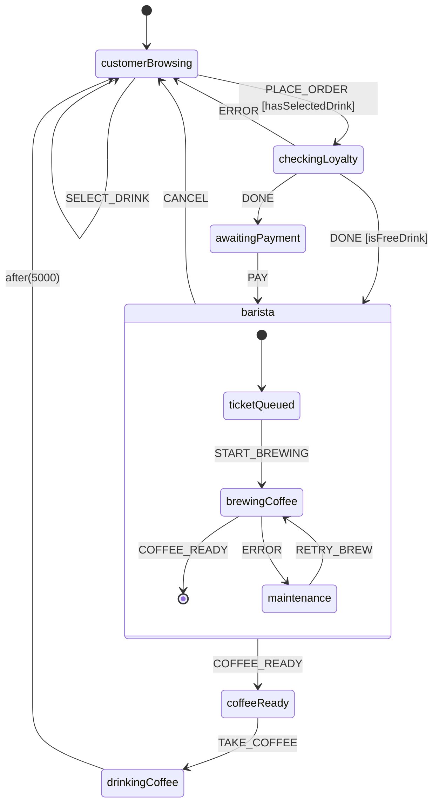

## The 4-Column Tuple Matrix

Every transition row in `@matrix-fsm` is a strongly-typed 4-element tuple:

```ts
[FROM, VIA, TO, OPTIONS?]
```

| Column | Role | Accepted Values |
| :--- | :--- | :--- |
| **1. `FROM`** | Source state or active actor | State string literal, array of state literals, `awaiting('...ing')`, `anyState()`, child FSM / `subMachine()`, `each()`, `all()`, `race()`, `any()` |
| **2. `VIA`** | Trigger event, timer, or epsilon | Event string (or `VIA[]` array), `'DONE'`, `'ERROR'`, `'ALL_DONE'`, `outcome(...)` name, `Error.name` / `_tag`, `after(ms)`, `every(ms)`, `always()` |
| **3. `TO`** | Target state or terminal marker | State string literal, `stay()`, `awaiting('...ing')`, `finalState(outcome?)`, child FSM / `subMachine()`, `each()`, `all()`, `race()`, `any()` |
| **4. `OPTIONS`** | Optional behavior object | `{ guard?, call?, input?, output? }` |

## Evaluation Order (First-Match-Wins)

When `send(event, payload)` is processed by the **FIFO Run-to-Completion** queue:

1. **Active Sub-Actor Delegation**: If a child actor (`subMachine`, `each`, `all`, `race`, `any`) is active and handles `event`, the child processes it first (Cooperative Cancel).
2. **Pass 1 (State-Specific)**: Rows whose `FROM` matches `currentState` and whose `VIA` matches `event` are scanned top-to-bottom. The **first row** with no `guard` (or `guard(ctx, payload) === true`) wins.
3. **Pass 2 (`anyState()` Wildcard)**: If Pass 1 matched nothing, rows with `FROM === anyState()` are evaluated top-to-bottom.
4. **Synchronous Side Effect (`call`)**: For normal and `stay()` transitions, `{ call: (m) => m._method }` executes synchronously before `always()` microsteps and timers arm.
5. **Microsteps (`always()`)**: Eventless `always()` rows on the newly entered state evaluate synchronously (capped at `MAX_SYNC_MICROSTEPS = 100`).

## DSL Primitives Reference

| Primitive | Column | Purpose |
| :--- | :---: | :--- |
| `stay()` | `TO` | Self-transition without `onExit`/`onEnter`, without bumping `stateEpoch`, and without cancelling running `awaiting()` tasks or timers. |
| `awaiting('...ing')` | `TO` / `FROM` | Async state that invokes `{ call }` with `(payload, abortSignal, ctx)` on entry and auto-aborts on exit. Routes `'DONE'`, `'ERROR'`, `outcome(...)`, or `Error.name` / `_tag`. |
| `outcome(event, payload?)` | Task Return | Returned from an `awaiting()` method to trigger a named domain event (`'APPROVED'`, `'DECLINED'`) instead of generic `'DONE'`. |
| `finalState(outcome?)` | `TO` | Terminal marker (`'DONE'` default, or named void `'CANCELLED'`). Tears down child actors and notifies parent machines. |
| `anyState()` | `FROM` | Global wildcard evaluated in Pass 2. Legal targets: `stay()`, `finalState()`, `initial` (reset), or any state when `VIA` includes `'ERROR'`. |
| `after(ms)` | `VIA` | One-shot timeout (`number | (ctx) => number`). Must leave the state (`stay()` forbidden); cleans up automatically on exit. |
| `every(ms)` | `VIA` | Recurring interval (`number | (ctx) => number`). Must target `stay()`; dynamically adapts when `ctx` changes. |
| `always()` | `VIA` | Synchronous eventless transition evaluated immediately upon state entry (and `patchContext` / `syncContext` updates). |
| `transitions(rows)` | Helper | Zero-cost identity macro (`x => x`) for extracting `[FROM, VIA]` groups strictly **larger than 3 rows** (`>= 4` rows). |

## Async `awaiting()` & Custom `outcome()` Routing

Return `outcome('OUTCOME_NAME', payload)` from an `awaiting()` task whenever an operation has distinct domain branches instead of throwing errors:

```ts
import { awaiting, createFSM, finalState, outcome } from '@matrix-fsm/core';

export const loyaltyFSM = createFSM<{
  events: { CHECK: { customerId: string } };
  states: 'idle' | 'checkingLoyalty' | 'vipConfirmed' | 'standardTier' | 'error';
  methods: {
    _checkTier: (p: { customerId: string }, signal: AbortSignal) => Promise<
      | ReturnType<typeof outcome<'VIP_TIER', { discount: number }>>
      | ReturnType<typeof outcome<'STANDARD_TIER'>>
    >;
  };
}>()({
  id: 'loyalty',
  initial: 'idle',
  // prettier-ignore
  transitions: [
    /* FROM               VIA              TO                           OPTIONS */
    ['idle',            'CHECK',         awaiting('checkingLoyalty'), { call: (m) => m._checkTier }],
    ['checkingLoyalty', 'VIP_TIER',      'vipConfirmed'],
    ['checkingLoyalty', 'STANDARD_TIER', 'standardTier'],
    ['checkingLoyalty', 'ERROR',         'error'],
    ['vipConfirmed',    'DONE',          finalState()],
  ],
});
```

## Hierarchical Actors & Parallel Combinators

Every machine created with `createFSM` or `createMachineFeature` can be placed directly in Column 1 (`FROM`) and Column 3 (`TO`):

- **`subMachine(fsm, 'alias')`**: Mount multiple isolated instances of the same child machine without ID collisions.
- **`each('itemsKey', childFSM, mapper?)`**: Parallel 1:N Master/Slave orchestration spawning one child per array item (with automatic singular key injection like `batchOrders -> batchOrder`) and emitting `'ALL_DONE'` with ordered payloads.
- **`all(...machines)`**: `Promise.all`-style parallel execution; emits `'ALL_DONE'` with `{ [idOrAlias]: payload }`, fail-fast aborts on `'ERROR'`.
- **`race(...machines)`**: `Promise.race`-style competition; first child to reach `finalState()` wins and immediately aborts losers.
- **`any(...machines)`**: `Promise.any`-style redundancy; first child reaching a non-`'ERROR'` `finalState()` wins.

## Visualizing with `toMermaid()`

Generate static `stateDiagram-v2` diagrams directly from any machine definition with `toMermaid(coffeeShopFSM)`:


