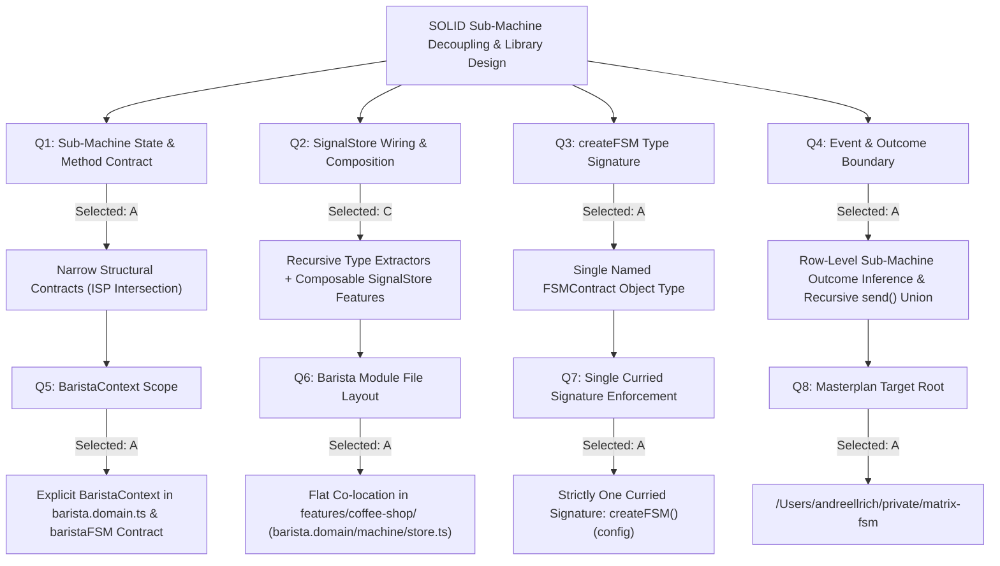

# Masterplan: SOLID Sub-Machine Contracts, Recursive Type Aggregation & Named `FSMContract` Ergonomics

**Generated At:** `2026-10-21T18:48:39+02:00` (Updated with 6 Critical Refinements at `2026-10-21T18:52:25+02:00`)  
**Target Project Root:** `/Users/andreellrich/private/matrix-fsm`  
**Status:** Design Tree Complete & Refinements Locked — Executing Implementation

---

## 1. Executive Summary

Previously, sub-machines such as `baristaFSM` in `apps/playground/src/app/features/coffee-shop/coffee-shop.machine.ts` were parameterized with the parent's full domain types (`createFSM<BaristaEvents, CoffeeShopContext, BaristaStates, CoffeeShopMethods>()`), violating three SOLID principles:
1. **Dependency Inversion Principle (DIP):** The child machine (`baristaFSM`) imported and depended on parent domain types (`CoffeeShopContext`, `CoffeeShopMethods`), preventing reuse in other workflows.
2. **Interface Segregation Principle (ISP):** Positional type parameters forced `baristaFSM` to accept the entire 7-field `CoffeeShopContext` and 6-method `CoffeeShopMethods` even when it only needed its own slice (`BaristaContext` and `_setBrewError`).
3. **Single Responsibility Principle (SRP):** `CoffeeShopEvents` manually duplicated child events (`START_BREWING`, `RETRY_BREW`) and child terminal outcomes (`COFFEE_READY`), while `CoffeeShopStore` monolithically implemented Barista state, methods, and tasks.

This masterplan replaces positional generics on `createFSM` with a single, canonical **Named `FSMContract` Object Type** (`createFSM<{ events?: ...; states?: ...; context?: ...; methods?: ... }>()({ ... })`), removes the `| (string & {})` escape hatch from `TransitionVia`, adds **row-level `VIA` outcome inference** for sub-machine rows (`[baristaFSM, 'COFFEE_READY', 'coffeeReady']`), implements **recursive type intersection/aggregation** across parent and child machines (`ExtractContext`, `ExtractMethods`, `ExtractStates`, `ExtractEvents`, `ExtractAwaitingNodes`, `TasksMapFor`) with safe filtering of omitted default records, and segregates the Barista domain, machine, and SignalStore feature (`barista.domain.ts`, `barista.machine.ts`, `barista.store.ts`).

---

## 2. Design Tree & Settled Decisions



### Decision Log & Rationale

| ID | Decision Title | Chosen Option | Rationale |
|----|----------------|---------------|-----------|
| **Q1** | Sub-Machine State & Method Contract | **A — Narrow Structural Contracts (ISP Type Intersection)** | Child machines declare only the minimal `context` and `methods` they directly require (zero imports from parent). Parent machines automatically intersect child contracts (`UnionToIntersection`) while keeping matrix syntax flat (`['awaitingPayment', 'PAY', baristaFSM]`). |
| **Q2** | SignalStore Wiring for Sub-Machines | **C — Recursive Type Aggregation + Composable SignalStore Features** | `ExtractContext<M>`, `ExtractMethods<M>`, `ExtractStates<M>`, and `TasksMapFor<M>` recursively aggregate requirements across `M` and all nested sub-machines. Sub-machine state, methods, and tasks are encapsulated in composable `signalStoreFeature` helpers (`withBarista()`). |
| **Q3** | `createFSM` Type Parameter Ergonomics | **A — Named Contract Object Type (`FSMContract`)** | Standardizes on `createFSM<{ events?: ...; states?: ...; context?: ...; methods?: ... }>()({ ... })` so a machine only specifies the facets it uses, eliminating positional generic slot counting. |
| **Q4** | Event & Final-Outcome Encapsulation | **A — Automatic Outcome & Event Inference (Zero Duplication)** | Removes child events and outcomes from `CoffeeShopEvents`. When column 1 (`FROM`) is a sub-machine (`baristaFSM`), column 2 (`VIA`) narrows to `ExtractFinalOutcomes<typeof FROM> \| BuiltInLifecycleEvent \| keyof TParentEvents`. `store.send()` recursively accepts parent and child events (excluding `finalState` outcomes). |
| **Q5** | `BaristaContext` in `baristaFSM` Contract | **A — Explicit `BaristaContext` in `barista.domain.ts` & `baristaFSM`** | `baristaFSM` declares `context: BaristaContext` (`selectedDrink`, `baristaResult`, `error`), so `TasksMapFor<typeof baristaFSM>` strictly types `brewingCoffee`. `CoffeeShopContext` drops `baristaResult` and gets `CoffeeShopContext & BaristaContext` via `ExtractContext<typeof coffeeShopFSM>`. Also includes unit test for omitted `context`. |
| **Q6** | File Layout for Segregated Barista Module | **A — Co-located in `apps/playground/src/app/features/coffee-shop/`** | `barista.domain.ts`, `barista.machine.ts`, and `barista.store.ts` co-located alongside `coffee-shop.domain.ts`, `coffee-shop.machine.ts`, and `coffee-shop.store.ts`, with zero imports from `coffee-shop.*` inside `barista.*`. |
| **Q7** | Uncurried `createFSM(config)` Overload | **A — Strictly One Curried Signature** | Removes the uncurried `createFSM(config)` overload completely so `createFSM<TContract extends FSMContract = {}>()(config)` is the sole signature across the codebase. |
| **Q8** | Target Project Root Directory | **A — `/Users/andreellrich/private/matrix-fsm`** | Masterplan written directly to the workspace root. |

---

## 3. Six Critical Refinements Applied

1. **True Method Segregation in `coffee-shop.domain.ts`:**
   - `_setBrewError` is removed from `CoffeeShopMethods` in `coffee-shop.domain.ts`. `_setBrewError` belongs exclusively to `BaristaMethods` in `barista.domain.ts` and is provided by `withBarista()` in `barista.store.ts` (and `checkingLoyalty` `ERROR` uses `_setLoyaltyError` or transitions cleanly without calling `_setBrewError`).
   - `withBarista()` in `barista.store.ts` provides `withState<BaristaContext>(initialBaristaContext)` and `withMethods` (`_setBrewError`), and is composed before `CoffeeShopStore`'s `withMethods` so `_finishCoffee` can reset `baristaResult: null` cleanly without duplicate/conflicting `withState` slices.

2. **Safe Default for Omitted `context` and `methods` in `FSMContract`:**
   - When `context` or `methods` is omitted in `FSMContract`, `ExtractContext<TFSM>` and `ExtractMethods<TFSM>` filter out unparameterized default records (`Record<string, unknown>`, `Record<string, any>`, `{}`) before applying `UnionToIntersection`, defaulting to `{}` only when no machine in the hierarchy declares a `context` or `methods` type. This prevents `[x: string]: unknown` index signatures from polluting `Partial<ExtractContext<TFSM>>` task returns.

3. **Remove `| (string & {})` Escape Hatch from `TransitionVia` & Recursively Extract Sub-Machine States:**
   - `| (string & {})` is removed from `TransitionVia` so Column 2 (`VIA`) is strictly checked when `events` is provided in `FSMContract` (when `events` is omitted, `keyof ContractEvents<T>` is `string`, which still allows untyped machines to use any event string).
   - `'barista'` is removed from `CoffeeShopStates` and `'COFFEE_READY'` is removed from `BaristaStates` (`finalState('COFFEE_READY')` is a terminal outcome node, not a resting state).
   - `ExtractStates<TFSM>` recursively unions `ExtractOwnStates<TFSM> | ExtractOwnStates<ExtractAllSubMachines<TFSM>>` so `store.fsmState()` in `CoffeeShopStore` includes `CoffeeShopStates | BaristaStates | 'barista'`.

4. **Preserve Contextual Typing on Inline `call` and `guard` Callbacks:**
   - `ValidateTransitionRows` validates `VIA` on rows where `FROM` is a sub-machine (`ExtractFinalOutcomes<Row[0]> | BuiltInLifecycleEvent | TEvent`) while preserving full contextual parameter inference for inline `guard: (ctx) => ...` and `call: (m) => m._method` in `transitions`.

5. **Update `transitions<...>()` Call Sites:**
   - `transitions<TContractOrContext, TMethods = never>([...])` supports `transitions<{ context?: C; methods?: M; events?: E; states?: S }>([...])`, `transitions<typeof someFSM>([...])`, and `transitions<TContext, TMethods>([...])`.

6. **Sync `blueprint.md`:**
   - `blueprint.md` is updated alongside `BEST_PRACTICES.md` and `.cursorrules` to use `@matrix-fsm/*`, curried `createFSM<{ ... }>()`, and `{ call: (m) => m._method }` instead of legacy `@ngx/flatstate` or dummy `events: {} as ...` objects.

---

## 4. Technical Specifications

### 4.1 `@matrix-fsm/core` — `packages/core/src/lib/types.ts`

- **`FSMContract` & Extractors:**
  ```ts
  export interface FSMContract {
    readonly events?: Record<string, any>;
    readonly states?: string;
    readonly context?: object;
    readonly methods?: object;
  }

  export type ContractEvents<T extends FSMContract> =
    T extends { readonly events: infer E extends Record<string, any> }
      ? E
      : Record<string, any>;

  export type ContractStates<T extends FSMContract> =
    T extends { readonly states: infer S extends string } ? S : string;

  export type ContractContext<T extends FSMContract> =
    T extends { readonly context: infer C extends object }
      ? C
      : {};

  export type ContractMethods<T extends FSMContract> =
    T extends { readonly methods: infer M extends object }
      ? M
      : {};
  ```
- **Filtering Unparameterized Defaults Before Intersection (`MergeExtractedObjects`):**
  ```ts
  export type UnionToIntersection<U> = (
    U extends any ? (k: U) => void : never
  ) extends (k: infer I) => void
    ? I
    : never;

  type IsDefaultOrUntypedObject<T> =
    [0] extends [1 & T]
      ? true
      : T extends object
        ? string extends keyof T
          ? true
          : keyof T extends never
            ? true
            : false
        : true;

  type FilterConcreteObjects<U> = U extends any
    ? IsDefaultOrUntypedObject<U> extends true
      ? never
      : U
    : never;

  export type MergeExtractedObjects<U, TFallback = {}> =
    [FilterConcreteObjects<U>] extends [never]
      ? TFallback
      : UnionToIntersection<FilterConcreteObjects<U>>;
  ```
- **Strict `TransitionVia` & Row-Level Sub-Machine Outcome Inference:**
  - `TransitionVia<TEvent, TContext, TMethods>` removes `| (string & {})`:
    ```ts
    export type TransitionVia<
      TEvent extends string = string,
      TContext = any,
      TMethods = any,
    > =
      | TEvent
      | BuiltInLifecycleEvent
      | ExtractedMarker<TContext, TMethods>;
    ```
  - In `TransitionRow`, when `from` is a sub-machine (`AnyFSMDefinition | SubMachineRef<any, any>`), the base constraint allows `string` in `via` so `TTransitions` is inferred with full contextual typing on `options` (`guard: (ctx) => ...`, `call: (m) => ...`), while `ValidateTransitionRows` maps over `TTransitions` and restricts index `1` (`via`) of any sub-machine row `Row` to:
    `ExtractFinalOutcomes<Row[0]> | BuiltInLifecycleEvent | TEvent`.
- **Recursive State, Context, Method, Event, and Task Extractors:**
  - `ExtractAllSubMachines<TFSM>`: Recursively extracts sub-machines (2 levels deep) from `TFSM`'s `transitions`.
  - `ExtractStates<TFSM>`: Unions `ExtractOwnStates<TFSM> | ExtractOwnStates<ExtractAllSubMachines<TFSM>>`, where `ExtractFromTarget<T>` returns `never` for `FinalNode<any>` so terminal outcomes like `'COFFEE_READY'` are not treated as resting states.
  - `ExtractContext<TFSM>`: `MergeExtractedObjects<ExtractOwnContext<TFSM> | ExtractOwnContext<ExtractAllSubMachines<TFSM>>>`.
  - `ExtractMethods<TFSM>`: `MergeExtractedObjects<ExtractOwnMethods<TFSM> | ExtractOwnMethods<ExtractAllSubMachines<TFSM>>>`.
  - `ExtractEvents<TFSM>`: Recursively unions `ExtractShallowEvents<TFSM> | ExtractShallowEvents<ExtractAllSubMachines<TFSM>>` (excluding `finalState` outcomes).
  - `ExtractAwaitingNodes<TFSM>`: Recursively unions awaiting states from `TFSM` and `ExtractAllSubMachines<TFSM>`.

### 4.2 `@matrix-fsm/angular` — `packages/angular/src/lib/with-state-machine.ts`

- Enforce at compile time that all required methods in `ExtractMethods<TFSM>` (from both the parent machine and all nested sub-machines) are satisfied either by the SignalStore `Input['methods']` (`withMethods` / `withBarista()`) or by `config.methods` in `withStateMachine(fsm, config)`.
  Specifically:
  - Compute `MissingStoreMethods<TFSM, Input> = Omit<ExtractMethods<TFSM>, keyof Input['methods']>`.
  - If `keyof MissingStoreMethods<TFSM, Input>` is NOT `never` (and `string` is not in `keyof ExtractMethods<TFSM>`), require `readonly methods: (() => MissingStoreMethods<TFSM, Input> & Partial<ExtractMethods<TFSM>>) | (MissingStoreMethods<TFSM, Input> & Partial<ExtractMethods<TFSM>>)` on `config` (and makes `config` required on `withStateMachine` when either `ExtractAwaitingNodes<TFSM>` is non-empty OR `keyof MissingStoreMethods<TFSM, Input>` is non-empty)!
  - That guarantees: if `CoffeeShopStore` omits `_setBrewError` (a method required by child `baristaFSM`) from its store methods and doesn't pass it in `config.methods`, TypeScript immediately raises a compile error on `withStateMachine(coffeeShopFSM, ...)`!

---

## 5. Verification Checklist

1. Refactor `barista.domain.ts`, `barista.machine.ts`, `barista.store.ts`, `coffee-shop.domain.ts`, `coffee-shop.machine.ts`, `coffee-shop.store.ts`, and `auth.machine.ts`.
2. Add compile-time `@ts-expect-error` tests in `packages/core/src/lib/core.spec.ts` and `packages/angular/src/lib/with-state-machine.spec.ts`:
   - Machine omitting `context` in `FSMContract` works without polluting `ExtractContext`.
   - `[baristaFSM, 'COFFEE_READY', 'coffeeReady']` compiles without `'COFFEE_READY'` in `CoffeeShopEvents`.
   - `[baristaFSM, 'TYPO_OUTCOME', 'coffeeReady']` triggers a TypeScript compile error.
   - Omitting `brewingCoffee` from `tasks` or `_setBrewError` from methods on `CoffeeShopStore` triggers a TypeScript compile error via recursive sub-machine extraction.
3. Update `blueprint.md`, `BEST_PRACTICES.md`, and `.cursorrules`.
4. Run `pnpm nx run-many -t test,lint,build` and ensure 100% green pass.
