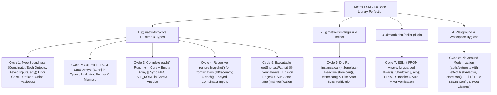

# Masterplan: Matrix-FSM v1.0 Base-Library Perfection (Ground-Truth TDD Execution Plan)

- **Generated**: `2026-10-31T21:55:34+01:00`
- **Baseline Commit**: `2d05b27` (`feat: add support for always transitions, infinite loop protection, snapshotting, and rule enhancements`)
- **Target Scope**: `@matrix-fsm/core`, `@matrix-fsm/angular`, `@matrix-fsm/angular/effect`, `@matrix-fsm/eslint-plugin`, `apps/playground`, and workspace hygiene (deferring `@matrix-fsm/router` to a dedicated next milestone).

---

## 1. Executive Summary

This Masterplan synthesizes the full architectural and mathematical review in `Angular SignalStore Finite State Machine.md` with a **line-by-line ground-truth audit of Commit `2d05b27`**.

### Key Architectural Invariants
1. **Zero Effect-TS Coupling in Core & Main Angular Entrypoint**:
   - `@matrix-fsm/core` has **0% Angular and 0% Effect-TS** dependencies.
   - `@matrix-fsm/angular` supports native `Promise` and RxJS `Observable` (`Subscribable`) out of the box with **zero runtime import of `effect`**, because Effect-TS is optional and not an industry-wide default.
   - `@matrix-fsm/angular/effect` (`packages/angular/src/effect/index.ts`) **MUST be retained** as a clean secondary entry point (`effectTaskAdapter` + `runEffect`) so applications that opt into Effect-TS get first-class Fiber interruption and `TaggedError` `_tag` routing without bloating non-Effect applications.
2. **Unified Angular Scoped Runtime (`createScopedMachineRunner`)**:
   - In `packages/angular/src/lib/with-state-machine.ts`, both `withStateMachine` (production `@ngrx/signals` store) and `createFeatureTester` (unit test harness) already delegate to `createScopedMachineRunner`. All Angular runtime enhancements must be implemented inside `createScopedMachineRunner` so production stores and test harnesses never drift.
3. **Complete 6-Point Hierarchical Sub-Actor & Combinator Contract**:
   - `subMachine`, `all()`, `race()`, `any()`, and `each()` work uniformly in both `@matrix-fsm/core` (`createMachineInstance`) and `@matrix-fsm/angular` (`createScopedMachineRunner`).
   - `each(key, childMachine)` executes a 1:N parallel pool of child instances, aggregates terminal outputs into an ordered array `ReadonlyArray<TerminalOutput>` passed as the `'ALL_DONE'` payload, and **synchronously dispatches `'ALL_DONE'` with `[]` via the FIFO queue** when the source array `ctx[key]` is empty (`[]`).
   - Combinator inputs (`all`, `race`, `any`) support **both** flat merged input objects (`UnionToIntersection<ExtractInput<TActors[number]>>`) **and** per-actor keyed input objects (`{ readonly [A in TActors[number] as A['id']]?: ExtractInput<A> }`) at both compile time and runtime.
   - `ResolveSingleViaPayload` and `ExtractSingleActorOutput` strictly filter to **terminal outputs only** (`ExtractTerminalOutputs<TActor>`), never polluting `ALL_DONE` / `DONE` combinator or `each()` payloads with intermediate `stay()` outputs.
   - `any(a, b)` requires an `'ERROR'` exit handler (or `anyState()` `'ERROR'`) enforced by both TypeScript (`ValidateTransitionRows`) and ESLint (`require-awaiting-handlers` / `require-exit-for-targets`).
   - Parent-level `after(ms)` timers on sub-actors, combinators, and `each()` (`[baristaFSM, after(5000), 'timeout']`, `[all(a, b), after(5000), 'timeout']`) track the parent state's lifetime and are **not** reset by internal child state transitions, while immediately aborting when the parent exits the sub-actor/combinator.
4. **Full Recursive `restoreSnapshot()` Across All Hierarchical Primitives**:
   - `getSnapshot()` and `restoreSnapshot()` recursively capture and restore `children` snapshots not only for single `subMachines`, but also for `all()`, `race()`, `any()` (`activeCombinator`), and `each()` (`eachRegistries`), followed by immediate `always()` evaluation and `after(ms)` timer scheduling.
5. **Column 1 (`FROM`) State Array Unwrapping (`[['stateA', 'stateB'], 'EVENT', 'target']`)**:
   - Supported uniformly across `@matrix-fsm/core` (`types.ts`, `fsm.ts`, `runner.ts`, `mermaid.ts`) and `@matrix-fsm/eslint-plugin` (`ast-utils.ts`, `no-unreachable-states.ts`, `require-exit-for-targets.ts`, `no-unreachable-transitions.ts` / `no-shadowed-transitions.ts`).
6. **Zoneless-Reactive `can(event, payload?)` & Optional Union Payload Ergonomics**:
   - Dry-run guard & transition query `.can(event, payload?): boolean` exposed on `MachineInstance` (`@matrix-fsm/core`), `StateMachineStoreMembers` (`@matrix-fsm/angular`), and `FeatureTester`.
   - In `@matrix-fsm/angular`, `store.can(event, payload?)` reads reactive Signals (`fsmState()` and `fsmContext()`) so calling `store.can('PAY')` inside Angular templates or `computed(() => store.can('PAY'))` automatically tracks dependencies in Zoneless Angular.
   - `SendFn<TFSM>` and `CanFn<TFSM>` use `[void] extends [ExtractEventPayload<TFSM, TEvent>]` so union payloads like `{ note?: string } | void` can be called with either 0 or 1 argument.
7. **Executable `getShortestPaths()` with 0-Event `always()` Epsilon Transitions**:
   - `getShortestPaths(fsm)` treats `always()` transitions as 0-event epsilon transitions (carrying forward `pathSoFar` without pushing a synthetic `'always()'` step), ensuring every step in a returned path is a real triggerable event.

---

## 2. Settled Decisions & Rationale

| ID | Decision Topic | Settled Choice | Rationale |
| :--- | :--- | :--- | :--- |
| **R1.Q1** | Overall Masterplan Scope | **Complete Base Library Perfection (All Cycles 31–50 equivalent)** | Lock down 100% of mathematical, runtime, TypeScript, ESLint, and DX guarantees in `@matrix-fsm/core`, `@matrix-fsm/angular`, `@matrix-fsm/eslint-plugin`, and `apps/playground` before tackling `@matrix-fsm/router`. |
| **R1.Q2** | Execution Architecture | **Architecture-First Grouping** | Leverage the unified `createScopedMachineRunner` in `@matrix-fsm/angular` and align `@matrix-fsm/core` (`runner.ts`) with it so every feature (`each`, `restoreSnapshot`, `can`, combinator inputs) is built cleanly without duplication. |
| **R1.Q3** | Sub-Actor & Combinator Contract | **Full 6-Point Mathematical Contract** | Guarantees zero deadlocks (empty `each()` arrays, unhandled `any()` errors, mid-actor `restoreSnapshot()`) and 100% sound payload typing (terminal-only outputs, array payloads for `each()`). |
| **R1.Q4** | DX, Tooling & Cleanup | **Include All Deliverables (preserving `@matrix-fsm/angular/effect`)** | Ships Zoneless-reactive `store.can()`, optional payload ergonomics, ESLint rules + Playground `configs.recommended` activation, and Playground `auth.feature.ts` modernization. |
| **R2.Q1** | `@matrix-fsm/angular/effect` | **Retain `@matrix-fsm/angular/effect` Secondary Entrypoint** | Core requirement: `@matrix-fsm/angular` must be usable without `effect` (not industry standard), while supporting it cleanly via `@matrix-fsm/angular/effect` (`taskAdapter: effectTaskAdapter`). |
| **R2.Q2** | TDD Cycle Structure | **Streamlined Ground-Truth TDD Plan** | Focuses implementation on the genuine open gaps in `2d05b27` while adding explicit verification/regression tests for capabilities already present in `2d05b27`. |
| **R2.Q3** | `getShortestPaths()` & `always()` | **0-Event Epsilon Transitions** | Omits `'always()'` from `steps` so returned paths can be replayed directly via `for (const step of path) store.send(step.via)`. |
| **R2.Q4** | Masterplan Output Location | **`/Users/andreellrich/private/matrix-fsm/masterplan-20261031-215534.md`** | Written directly to confirmed project root with exhaustive technical detail. |

---

## 3. Design Tree & Ground-Truth Audit of Commit `2d05b27`



### Ground-Truth Matrix: What Exists in `2d05b27` vs. What Must Be Built

| Capability | Status in Commit `2d05b27` | Action Required in This Masterplan |
| :--- | :--- | :--- |
| `ValidateTransitionRows` when `states` omitted in `createMachineFeature` | Already active (`ValidateTransitionRows` in `packages/core/src/lib/types.ts` lines 977–1075 has **no** `string extends TStates` short-circuit). | Add compile-time `@ts-expect-error` regression tests in `with-state-machine.spec.ts` to lock in `call` and `input` validation when `states` is inferred. |
| `all()`, `race()`, `any()` Feature Actors in `withStateMachine` | Already unified via `createScopedMachineRunner` (`enterCombinatorNode`, lines 1656–1836 of `with-state-machine.ts`). | Add real Angular `signalStore(withStateMachine(...))` integration test with `all(baristaFSM, bakeryFSM)` + add per-actor keyed input unwrapping (`inputMapped[childFSM.id]`). |
| `store.actors` Strong Typing | Already typed as `ActorsMapFor<TFSM>` (`store.actors.barista()` returns `Signal<ActorStateOf<M> \| null>`, lines 423–427 & 1033–1075 of `with-state-machine.ts`). | Extend `getOrCreateActorSignal` / `ExtractAllSubMachines` verification tests so combinator children (`all`/`race`/`any`) are also covered in real `signalStore` tests. |
| `always()` on `initial`, `restoreSnapshot()`, `output` & `finalState()` | Already implemented in both `runner.ts` (lines 610–621, 773–778, 803–808) and `with-state-machine.ts` (lines 2148–2159, 2331–2336, 2403–2408) via `sendInternal('__always__')` / `dispatchInternal('__always__')`. | Add explicit unit tests for `always()` with `output` and `finalState()` in sub-actors and after `restoreSnapshot()`. |
| `each(key, childFSM)` Runtime & Types | **MISSING in Core `runner.ts`**, **BUGGY on `[]` in Angular `with-state-machine.ts`** (hangs when `rawArray.length === 0`), and **MISSING payload/output types in `types.ts`**. | **BUILD**: Full `each()` pool execution in `runner.ts`, synchronous `sendInternal('ALL_DONE', [])` when `rawArray.length === 0` in both Core and Angular, and `EachNode` output array typing in `types.ts`. |
| `restoreSnapshot()` for Combinators (`all`, `race`, `any`) & `each()` | **MISSING**: Both `runner.ts` (line 768) and `with-state-machine.ts` (line 2316) spawn fresh combinator/`each` children on `restoreSnapshot()` without restoring `snapshot.children[childId]`. | **BUILD**: Recursively restore child snapshots for `activeCombinator` and `each` pools in both `runner.ts` and `with-state-machine.ts`. |
| Combinator Output Types (`ResolveSingleViaPayload`) & `any()` Error Enforcement | **MISSING**: `ResolveSingleViaPayload` (`types.ts` line 891) only handles `IsSubMachineNode<From>`, not `CombinatorNode` or `EachNode`; `ValidateTransitionRows` (`types.ts` line 1031) does not validate `CombinatorNode` exit handlers. | **BUILD**: Resolve `all()` (`{ [actorId]: TerminalOutput }`), `race()`/`any()` (union of child terminal outputs), and `each()` (`ReadonlyArray<TerminalOutput>`) payloads in `types.ts`, and validate combinator exits. |
| Combinator Keyed vs. Flat Inputs | **PARTIAL**: `ExtractInput` (`types.ts` line 1243) only permits flat `UnionToIntersection`; runtime passes `inputMapped` as-is to every child in `all(a, b)`. | **BUILD**: Support both flat intersection and keyed `{ [actorId]?: ActorInput }` in `ExtractInput` and unwrap `inputMapped[childFSM.id]` when present in `runner.ts` and `with-state-machine.ts`. |
| Column 1 (`FROM`) State Arrays `[['a', 'b'], 'EV', 'to']` | **MISSING**: `types.ts` (`TransitionFrom`), `fsm.ts` (`resolveSourceId` / `buildFSM`), `runner.ts`, `mermaid.ts`, and `ast-utils.ts` only accept single nodes in Column 1 (`FROM`). | **BUILD**: Full support for `readonly (TState \| SubMachine \| ... )[]` in Column 1 (`FROM`) across Core, Types, Mermaid, and ESLint. |
| `getShortestPaths()` on `always()` | **BUGGY**: `mermaid.ts` (line 243) pushes `{ via: 'always()' }` as a step instead of treating `always()` as a 0-event epsilon transition. | **BUILD**: Treat `isAlwaysNode(via)` as a 0-event epsilon transition in `getShortestPaths()` (inheriting `pathSoFar` without adding a synthetic step). |
| Dry-Run `can(event, payload?)` & Optional Union Payloads | **MISSING**: No `.can()` method on `MachineInstance`, `StateMachineStoreMembers`, or `FeatureTester`. `SendFn` requires `undefined` arg for `{ a?: string } \| void`. | **BUILD**: Implement dry-run `.can(event, payload?)` in Core, Zoneless-reactive `store.can()` in Angular, and `tester.can()`, plus `[void] extends [Payload]` rest parameter typing. |
| ESLint Rules & Playground Preset | `align-matrix-columns` `--fix` and `configs.recommended` already exist, but: (1) `no-unreachable-transitions` / `no-shadowed-transitions` misses unguarded `always()` shadowing all subsequent rows for the same `FROM` state, (2) `require-awaiting-handlers` / `require-exit-for-targets` misses `'ERROR'` enforcement on `any()`, (3) `ast-utils.ts` misses Column 1 arrays, and (4) `apps/playground/eslint.config.mjs` does not enable `configs.recommended`. | **BUILD**: Upgrade ESLint rules and enable `configs.recommended` in `apps/playground/eslint.config.mjs`. |
| Playground `auth` Feature & Workspace Root Cleanup | `apps/playground/src/app/features/auth/` still splits `auth.machine.ts` + `auth.store.ts` using `createFSM`, and root has a dirty git status for `Masterplan für Matrix-FSM Architektur-Perfektion.md`. | **BUILD**: Refactor `auth` to `auth.feature.ts` using `createMachineFeature` + `effectTaskAdapter` from `@matrix-fsm/angular/effect`, wire `store.can()` in Playground templates, and clean up workspace root files. |

---

## 4. Technical Specifications & TDD Execution Cycles

> [!IMPORTANT]
> **Execution Protocol for the Coding Agent**:
> Execute the 8 cycles below strictly following **Test-Driven Development (🔴 RED → 🟢 GREEN → 🔵 REFACTOR)**.
> After each cycle, run the relevant package test suite (`pnpm nx test core`, `pnpm nx test angular`, `pnpm nx test eslint-plugin`), and at the end run `pnpm nx run-many -t test,lint,build`.

---

### Cycle 1: Type Soundness for Combinators, `each()`, Terminal-Only Output Payloads & Optional Event Unions (`@matrix-fsm/core` & `@matrix-fsm/angular`)

#### 🔴 RED (`packages/core/src/lib/core.spec.ts` & `packages/angular/src/lib/with-state-machine.spec.ts`)
1. **Terminal-Only Output Extraction & Combinator/`each()` Payload Inference**:
   - Define `subA` with both an intermediate output (`PROGRESS: { percent: number }` on `stay()`) and a terminal output (`COFFEE_READY: { cup: string }` on `finalState()`), and `subB` with terminal output (`BAKERY_READY: { pastry: string }` on `finalState()`).
   - Verify in `createFSM` and `createMachineFeature` that:
     - In `[all(subA, subB), 'ALL_DONE', 'done', { call: (m) => m._onAllDone }]`, the payload passed to `_onAllDone` is inferred as `{ readonly [subA.id]: { cup: string }; readonly [subB.id]: { pastry: string } }` (strictly excluding `{ percent: number }`!).
     - In `[race(subA, subB), 'DONE', 'done', { call: (m) => m._onRaceDone }]` and `[any(subA, subB), 'DONE', 'done', { call: (m) => m._onAnyDone }]`, the payload is inferred as `{ cup: string } | { pastry: string }`.
     - In `[each('items', subA), 'ALL_DONE', 'done', { call: (m) => m._onEachDone }]`, the payload is inferred as `ReadonlyArray<{ cup: string }>`.
2. **Combinator Input Ergonomics (Flat Intersection OR Actor-Keyed Object)**:
   - Verify that transitioning into `all(subA, subB)` where `subA` requires `inputs: { drink: string }` and `subB` requires `inputs: { dough: string }` compiles cleanly with **either**:
     - Flat merged input: `{ input: () => ({ drink: 'Espresso', dough: 'Croissant' }) }`
     - Keyed input by actor ID: `{ input: () => ({ [subA.id]: { drink: 'Espresso' }, [subB.id]: { dough: 'Croissant' } }) }`
   - Verify that omitting `{ input: ... }` when transitioning into `all(subA, subB)` (including inside `createMachineFeature` without explicit `states` in the contract generic) triggers a `@ts-expect-error`!
3. **`any()` Mandatory `'ERROR'` Handler Validation**:
   - Write a `@ts-expect-error` test verifying that transitioning into `any(subA, subB)` without handling `'ERROR'` on `any(subA, subB)` (or `anyState()`) produces a compile-time error in `ValidateTransitionRows`.
4. **Optional Union Event Payload Ergonomics (`[void] extends [Payload]`)**:
   - Define an event `OPTIONAL_EV: { note?: string } | void` and verify that both `store.send('OPTIONAL_EV')` (0 args) and `store.send('OPTIONAL_EV', { note: 'hi' })` (1 arg) compile without errors.

#### 🟢 GREEN (`packages/core/src/lib/types.ts` & `packages/angular/src/lib/with-state-machine.ts`)
1. **Terminal-Only Single Actor Output Helper (`packages/core/src/lib/types.ts`)**:
   - Add `ExtractTerminalOutputPayload<TActor>`:
     - Extract `TOutputsMap = ExtractOutputsMap<TActor>` and `TTerminalKeys = Extract<ExtractFinalOutcomes<TActor>, keyof TOutputsMap>`.
     - When `[keyof TOutputsMap] extends [never]`, fall back to `ExtractContext<TActor>`.
     - When `[TTerminalKeys] extends [never]`, use `TOutputsMap[keyof TOutputsMap]`.
     - Otherwise, resolve strictly to `TOutputsMap[TTerminalKeys]` so intermediate `stay()` outputs are excluded!
2. **Extend `ResolveSingleViaPayload` (`packages/core/src/lib/types.ts` lines 891–907)**:
   - When `From extends CombinatorNode<'all', infer TMachines>`:
     - If `SingleVia extends 'ALL_DONE'`, resolve to `{ readonly [M in TMachines[number] as M['id']]: ExtractTerminalOutputPayload<M> }`.
     - If `SingleVia extends 'DONE'`, resolve to `ReadonlyArray<ExtractTerminalOutputPayload<TMachines[number]>>`.
   - When `From extends CombinatorNode<'race' | 'any', infer TMachines>`:
     - If `SingleVia extends 'DONE' | ExtractFinalOutcomes<TMachines[number]>`, resolve to `ExtractTerminalOutputPayload<TMachines[number]>`.
   - When `From extends EachNode<any, infer TSub>`:
     - If `SingleVia extends 'ALL_DONE' | 'DONE'`, resolve to `ReadonlyArray<ExtractTerminalOutputPayload<TSub>>`.
3. **Dual Combinator Input Type (`packages/core/src/lib/types.ts` lines 1230–1249)**:
   - Introduce `ExtractCombinatorInput<TActors extends readonly AnyFSMDefinition[]>`:
     - Allow either `UnionToIntersection<ExtractNonEmptyInput<TActors[number]>>` **or** `{ readonly [A in TActors[number] as IsDefaultOrUntypedObject<ExtractInput<A>> extends false ? A['id'] : never]: ExtractInput<A> } & { readonly [A in TActors[number] as IsDefaultOrUntypedObject<ExtractInput<A>> extends true ? A['id'] : never]?: ExtractInput<A> }`.
   - Update `ExtractInput<TFSM>` so when `TFSM extends CombinatorNode<any, infer TActors>`, it returns `ExtractCombinatorInput<TActors>`.
   - Update `HasRequiredSubMachineInput<To>` so `EachNode<any, any>` does not force a mandatory `input` mapper (since `each('key', sub)` automatically maps each item from `ctx[key]`), whereas `CombinatorNode` requires `input` if any child has required `inputs`.
4. **Validate `any()` Error Exit in `ValidateTransitionRows` (`packages/core/src/lib/types.ts` line 1031)**:
   - Add `ValidateCombinatorOutputs<To, TTransitions>`: when `To extends CombinatorNode<'any', any>`, verify that `'ERROR'` is handled either on `To` (`HandledEventsForCombinator<To, TTransitions>`) or on `anyState()` (`HandledWildcardEvents<TTransitions>`).
5. **Optional Event Payload Rest Parameters (`packages/angular/src/lib/with-state-machine.ts` lines 407–415)**:
   - Update `SendFn<TFSM>` (and `CanFn<TFSM>` in Cycle 6) from `ExtractEventPayload<TFSM, TEvent> extends void | undefined` to:
     ```ts
     [void] extends [ExtractEventPayload<TFSM, TEvent>]
       ? [event: TEvent, payload?: ExtractEventPayload<TFSM, TEvent>]
       : [undefined] extends [ExtractEventPayload<TFSM, TEvent>]
         ? [event: TEvent, payload?: ExtractEventPayload<TFSM, TEvent>]
         : unknown extends ExtractEventPayload<TFSM, TEvent>
           ? [event: TEvent, payload?: unknown]
           : [event: TEvent, payload: ExtractEventPayload<TFSM, TEvent>]
     ```

---

### Cycle 2: Column 1 (`FROM`) State Array Support (`[['stateA', 'stateB'], 'EVENT', 'target']`) in Core & Mermaid

#### 🔴 RED (`packages/core/src/lib/core.spec.ts`)
1. Write a runtime + compile-time test where a transition matrix uses an array of states/actors in Column 1 (`FROM`):
   - `['idle', 'START', 'step1']`
   - `['step1', 'FAIL', 'error']`
   - `[['step1', 'error'], 'RESET', 'idle', { call: (m) => m._onReset }]`
   - Verify that `instance.send('RESET')` transitions from both `'step1'` and `'error'` to `'idle'` and invokes `_onReset`.
2. Verify that `toMermaid(fsm)` renders an edge for each element of the Column 1 array (`step1 --> idle : RESET` and `error --> idle : RESET`), and `getShortestPaths(fsm)` traverses edges originating from Column 1 arrays.

#### 🟢 GREEN (`packages/core/src/lib/types.ts`, `fsm.ts`, `runner.ts`, `mermaid.ts`)
1. **`packages/core/src/lib/types.ts`**:
   - Define `SingleTransitionFrom<TState, TContext, TMethods>` and allow ` readonly SingleTransitionFrom<TState, TContext, TMethods>[]` in `TransitionFrom` and `TransitionRow` (lines 409–518).
   - Update `ExtractFromSource<T>` (line 1101) to unwrap arrays: `T extends readonly (infer El)[] ? ExtractFromSource<El> : ...`.
   - Update `ExtractSubMachineFromNode<Node>` (line 1127) to unwrap arrays: `Node extends readonly (infer El)[] ? ExtractSubMachineFromNode<El> : ...`.
   - Update `HandledEventsForSubMachineId` (line 742) so if `RFrom` is an array containing `SubMachine`, it counts as handling `RVia` for that `SubMachine`.
2. **`packages/core/src/lib/fsm.ts`**:
   - Add `resolveSourceIds(source: unknown): string[]`:
     ```ts
     export function resolveSourceIds(source: unknown): string[] {
       if (Array.isArray(source)) {
         return source.flatMap((el) => resolveSourceIds(el));
       }
       return [resolveSourceId(source)];
     }
     ```
   - In `buildFSM` (lines 212–240), iterate over `const fromItems = Array.isArray(from) ? from : [from]` when registering `states`, `awaitingStates`, `subMachines`, `eachNodes`, and `combinatorNodes`.
   - In `hasTransitionFor` (line 263) and `evaluateRowList` (line 294), check `resolveSourceIds(from).includes(state)` instead of `resolveSourceId(from) === state`.
3. **`packages/core/src/lib/runner.ts` & `packages/angular/src/lib/with-state-machine.ts`**:
   - In `scheduleStateTimers` (`runner.ts` line 203 & `with-state-machine.ts` line 1877), use `const srcIds = resolveSourceIds(from)` and check `(srcIds.includes(stateName) || srcIds.includes('*'))`.
4. **`packages/core/src/lib/mermaid.ts`**:
   - In `renderMachineBody` (line 85) and `getShortestPaths` (line 233), unwrap `Array.isArray(from) ? from : [from]` so every source node in a Column 1 array emits its Mermaid edge and is traversed by `getShortestPaths`.

---

### Cycle 3: Complete `each(arrayKey, childFSM)` Support in Core `runner.ts` & Synchronous Empty-Array `[]` FIFO Dispatch

#### 🔴 RED (`packages/core/src/lib/core.spec.ts` & `packages/angular/src/lib/with-state-machine.spec.ts`)
1. **Core & Angular `each()` Parallel Pool Execution + Ordered Output Array Aggregation**:
   - Write a test in both `core.spec.ts` (`createMachineInstance`) and `with-state-machine.spec.ts` (`signalStore(withStateMachine(...))` AND `createFeatureTester`) where `each('drinks', baristaFSM)` runs for a 2-item array `drinks: [{ id: '1', name: 'Espresso' }, { id: '2', name: 'Latte' }]`.
   - Verify that when all items reach `finalState()`, `[each('drinks', baristaFSM), 'ALL_DONE', 'orderReady', { call: (m) => m._saveAll }]` receives the ordered array `[{ drinkName: 'Espresso' }, { drinkName: 'Latte' }]`!
2. **Empty Array `[]` Synchronous FIFO Completion**:
   - Write a test in both `core.spec.ts` and `with-state-machine.spec.ts` where `each('drinks', baristaFSM)` is entered when `ctx.drinks` is `[]`.
   - Verify that:
     1. The transition from `each('drinks', baristaFSM)` via `'ALL_DONE'` to `'orderReady'` completes **synchronously within the same `send()` call** (0 async ticks required!).
     2. The `'ALL_DONE'` payload received by `_saveAll` is an empty array `[]` (NOT `undefined`!).

#### 🟢 GREEN (`packages/core/src/lib/runner.ts` & `packages/angular/src/lib/with-state-machine.ts`)
1. **`packages/angular/src/lib/with-state-machine.ts` (`syncEachInstances` & `checkEachAllDone`, lines 1495–1600)**:
   - In `checkEachAllDone(eachNode)`:
     - When `rawArray.length === 0` (i.e. `!registry || registry.size === 0`), if `untracked(() => fsmStateSig()) === eachNode.id`, immediately call `dispatchInternal('ALL_DONE', [], true, true)`! (Because `dispatchInternal` uses `eventQueue`, calling it inside `processOneEvent` queues `'ALL_DONE'` with `[]` into the active synchronous FIFO loop!).
2. **`packages/core/src/lib/runner.ts`**:
   - Add `activeEachPool: { readonly node: EachNode<any, any>; readonly instances: Map<string, MachineInstance<any>>; readonly orderedIds: string[] } | null = null` and `destroyActiveEachPool()`.
   - Implement `enterEachIfNeeded(eachNode, inputMapped)` in `runner.ts` matching `with-state-machine.ts`:
     - Read `const rawArray = Array.isArray(ctx[eachNode.key]) ? ctx[eachNode.key] : []`.
     - If `rawArray.length === 0`, immediately call `sendInternal('ALL_DONE', [], true, true)` and return.
     - Otherwise, spawn a `createMachineInstance(eachNode.machine, ...)` for each item, track completion in insertion order, and when all instances are `isDone()`, collect their terminal payloads into an ordered array `results` and call `sendInternal('ALL_DONE', results, true, true)`.
     - Also support broadcasting unhandled events to active `each()` child instances in `processOneEvent`, and `isPending()` checking `activeEachPool`.

---

### Cycle 4: Recursive `restoreSnapshot()` for Combinators (`all`, `race`, `any`) & `each()`, plus Keyed Combinator Inputs

#### 🔴 RED (`packages/core/src/lib/core.spec.ts` & `packages/angular/src/lib/with-state-machine.spec.ts`)
1. **Combinator `restoreSnapshot()` Test**:
   - Enter `all(baristaFSM, bakeryFSM)` where `baristaFSM` has progressed to `'brewingCoffee'` and `bakeryFSM` is in `'baking'`.
   - Call `const snap = instance.getSnapshot()` (and `store.getSnapshot()`).
   - Create a fresh machine/store instance, call `restoreSnapshot(snap)`, and verify:
     - `baristaFSM` is restored to `'brewingCoffee'` (not reset to its initial state!) and `store.actors.barista()` reflects its restored context.
     - Sending child completion events finishes both actors and transitions the parent out of `all(baristaFSM, bakeryFSM)` via `'ALL_DONE'`.
2. **Keyed Combinator Input Runtime Test**:
   - Transition into `all(baristaFSM, bakeryFSM)` with `{ input: () => ({ barista: { selectedDrink: espresso }, bakery: { pastry: 'Croissant' } }) }` in a real Angular `signalStore(withStateMachine(...))` and in `createMachineInstance`, verifying that `baristaFSM` receives `{ selectedDrink: espresso }` and `bakeryFSM` receives `{ pastry: 'Croissant' }`.

#### 🟢 GREEN (`packages/core/src/lib/runner.ts` & `packages/angular/src/lib/with-state-machine.ts`)
1. **Per-Actor Keyed Input Resolution**:
   - Write a helper `resolveChildCombinatorInput(inputMapped: Record<string, unknown> | null | undefined, childId: string)`:
     - If `inputMapped && typeof inputMapped === 'object' && childId in inputMapped && typeof inputMapped[childId] === 'object' && inputMapped[childId] !== null`, merge `{ ...inputMapped, ...(inputMapped[childId] as Record<string, unknown>) }` (or for feature children in Angular, pass `inputMapped[childId] as Record<string, unknown>`).
   - Use this helper in `enterCombinatorIfNeeded` (`runner.ts` line 331) and `enterCombinatorNode` (`with-state-machine.ts` line 1782).
2. **Recursive `restoreSnapshot()` for Combinators and `each()`**:
   - In `runner.ts` (`restoreSnapshot`, lines 768–771):
     - After `enterCombinatorIfNeeded(combNode, currentContext)`, if `activeCombinator && snapshot.children`, iterate over `activeCombinator.instances` and call `childInst.restoreSnapshot(childSnap)` for each `childFSM.id` present in `snapshot.children`.
     - If `eachNode = fsm.eachNodes.get(currentState)` is present, call `enterEachIfNeeded(eachNode, currentContext)` and restore any matching `snapshot.children[ `${eachNode.id}:${itemId}` ]`.
   - In `with-state-machine.ts` (`restoreSnapshot`, lines 2316–2326):
     - After `enterCombinatorNode(combNode, snapshot.context)`, if `activeCombinator && snapshot.children`, iterate over `activeCombinator.children` and call `child.restoreSnapshot?.(childSnap)` for each `childFSM.id` in `snapshot.children`, then bump `combinatorTickSig`.
     - Similarly save and restore `eachRegistries` children in `getSnapshot()` / `restoreSnapshot()` and call `publishChildSnapshots()`.

---

### Cycle 5: Executable `getShortestPaths()` (0-Event `always()` Epsilon Edges) & Sub-Actor `after(ms)` Verification

#### 🔴 RED (`packages/core/src/lib/core.spec.ts`)
1. **`getShortestPaths()` with `always()` and `all()`**:
   - Create a machine where `initial: 'step1'` has `['step1', always(), 'step2']`, `['step2', 'START_ALL', all(subA, subB)]`, and `[all(subA, subB), 'ALL_DONE', 'completed']`.
   - Verify that:
     - `paths['step2']` is `[]` (0 external events needed because `always()` fires automatically on entry!).
     - `paths['completed']` has `[{ from: 'step2', via: 'START_ALL', to: 'all:subA,subB', ... }, { from: 'all:subA,subB', via: 'ALL_DONE', to: 'completed', ... }]` (no `'always()'` step in the path!).
     - Replaying `paths['step2'].forEach(s => instance.send(s.via))` on a fresh instance leaves `instance.state() === 'step2'`.
2. **Parent `after(ms)` Timeout on Active Sub-Actor & Combinator**:
   - Write a fake-timers test (`vi.useFakeTimers()`) where a parent transitions into `baristaFSM` (which transitions internally from `'ticketQueued'` to `'brewingCoffee'` at `t = 1000ms`), and the parent defines `[baristaFSM, after(5000), 'timeout']`.
   - Verify:
     1. At `t = 1000ms`, `baristaFSM` transitions to `'brewingCoffee'` and the parent's 5000ms timer is **not** cancelled.
     2. At `t = 5000ms`, the parent's `after(5000)` timer fires, transitions the parent to `'timeout'`, and destroys `baristaFSM`.
     3. Conversely, if `baristaFSM` finishes at `t = 3000ms` (`'COFFEE_READY'`), the parent's 5000ms timer is cleared and never fires at `t = 5000ms`.

#### 🟢 GREEN (`packages/core/src/lib/mermaid.ts`)
1. In `packages/core/src/lib/mermaid.ts` (`getShortestPaths`, lines 222–254):
   - When `isAlwaysNode(via)` (or an array containing `isAlwaysNode`):
     - Do **not** append `{ from: current, via: 'always()', ... }` to `result[targetKey]`. Instead, set `result[targetKey] = [...pathSoFar]` and `queue.unshift(targetKey)` (0-weight BFS edge / 0-1 BFS) so epsilon transitions are traversed immediately with 0 added event steps!

---

### Cycle 6: Dry-Run `.can(event, payload?)` (Core, Zoneless-Reactive Angular Store & FeatureTester) & Live `store.actors` Sync

#### 🔴 RED (`packages/core/src/lib/core.spec.ts` & `packages/angular/src/lib/with-state-machine.spec.ts`)
1. **Core `instance.can(event, payload?)`**:
   - Verify `instance.can('PAY')` returns `false` when no row matches `'PAY'` in the current state.
   - Verify `instance.can('PAY', { amount: 2 })` returns `false` when a matching row exists but its `guard(ctx, payload)` returns `false`.
   - Verify `instance.can('PAY', { amount: 10 })` returns `true` when a matching row on the active sub-actor, active combinator, current state, or `anyState()` matches and its guard returns `true`, **without** mutating state, context, or firing `call` methods.
2. **Zoneless-Reactive `store.can(event, payload?)` in `@matrix-fsm/angular`**:
   - Create a SignalStore with `withStateMachine` where `'PAY'` is guarded by `guard: (ctx) => ctx.balance >= 10`.
   - Create `const canPay = computed(() => store.can('PAY'))`.
   - Verify `canPay()` is initially `false`.
   - Call `patchState(store, { balance: 15 })` (without changing `fsmState`) and verify `canPay()` automatically recomputes to `true`!
3. **Synchronous Sub-Actor `call` Mutation Live in `store.actors`**:
   - Verify that when an active sub-actor (`baristaFSM`) executes a synchronous `stay()` transition with `{ call: (m) => m._addExtraShot }` that calls `patchState(actorStore, { shots: 2 })`, `store.actors.barista()?.shots` immediately reads `2`.

#### 🟢 GREEN (`packages/core/src/lib/runner.ts`, `packages/angular/src/lib/with-state-machine.ts`)
1. **`packages/core/src/lib/runner.ts` (`MachineInstance.can`)**:
   - Add `readonly can: (event: string, payload?: unknown) => boolean;` to `MachineInstance<TFSM>`.
   - Implement `can(event, payload)`:
     - If `isDestroyed`, return `false`.
     - If `activeSubMachine && activeSubRef && activeSubMachine.can(event, payload)`, return `true`.
     - If `activeCombinator && !fsm.hasTransitionFor(activeCombinator.node.id, event)` and `activeCombinator.instances.some((inst) => !inst.isDone() && inst.can(event, payload))`, return `true`.
     - If `activeEachPool && !fsm.hasTransitionFor(activeEachPool.node.id, event)` and `[...activeEachPool.instances.values()].some((inst) => !inst.isDone() && inst.can(event, payload))`, return `true`.
     - Otherwise, return `fsm.evaluate(currentState, event, payload, readEffectiveContext()).matched`.
2. **`packages/angular/src/lib/with-state-machine.ts` (`store.can` & `tester.can`)**:
   - Define `export type CanFn<TFSM extends AnyFSMDefinition>` with the same optional-payload rest parameter signature as `SendFn<TFSM>`, returning `boolean`.
   - Add `readonly can: CanFn<TFSM>;` to `StateMachineStoreMembers<TFSM>`, `SubMachineRuntimeNode<TFSM>`, and `FeatureTester<TFSM>`.
   - Inside `createScopedMachineRunner`, implement `can(event, payload)`:
     - Flush pending watches via `flushPendingSignalWatches()`.
     - **Read reactive signals (`const currentState = fsmStateSig(); const currentCtx = fsmContext();`)** (NOT `untracked`!) so Angular's reactive graph tracks both `fsmStateSig` and `fsmContext` (and any `activeSubNode` / `activeCombinator` signals) whenever `store.can(...)` is called inside a template or `computed()`!
     - Check active sub-node (`activeSubNode.can?.(event, payload)`), active combinator children (`child.can?.(event, payload)`), active `each` pool children, and finally `fsm.evaluate(currentState, event, payload, currentCtx).matched`.

---

### Cycle 7: ESLint Graph Rules — Column 1 Arrays, Unguarded `always()` Shadowing, `any()` Error Handler & Auto-Fixer Verification

#### 🔴 RED (`packages/eslint-plugin/src/lib/eslint-plugin.spec.ts`)
1. **Column 1 (`FROM`) Array Unwrapping**:
   - `no-unreachable-states`: Test `['idle', 'GO', 'step1']`, `['step1', 'FAIL', 'error']`, `[['step1', 'error'], 'RESET', 'idle']` — verify it passes with 0 errors (and flags `'ghost'` if `[['step1', 'ghost'], 'RESET', 'idle']` is used).
   - `require-exit-for-targets`: Test `[[subA, subB], 'CANCEL', 'idle']` — verify it counts as a valid exit for both `subA` and `subB`.
   - `no-shadowed-transitions` (`no-unreachable-transitions`): Test where an unguarded `[['idle', 'active'], 'RESET', 'idle']` precedes `['active', 'RESET', 'special', { guard: isSpecial }]` — verify it flags the shadowed `'active'` row!
2. **Unguarded `always()` Shadows All Subsequent Rows for Same `FROM` State**:
   - In `no-shadowed-transitions` (`no-unreachable-transitions`), test `['checking', always(), 'done']` (unguarded `always()`) followed by `['checking', 'CANCEL', 'idle']`. Verify the `'CANCEL'` row is flagged as unreachable because `'checking'` exits synchronously on entry via `always()`.
3. **`any()` Combinator Requires `'ERROR'` Exit Handler**:
   - In `require-awaiting-handlers`, test a transition entering `any(subA, subB)` in Column 3 (`TO`) that handles `[any(subA, subB), 'DONE', 'ok']` but omits `[any(subA, subB), 'ERROR', 'fail']` (and has no `[anyState(), 'ERROR', ...]`). Verify `require-awaiting-handlers` reports a missing `'ERROR'` handler for `any(subA, subB)`.
4. **`align-matrix-columns` Auto-Fixer Verification**:
   - Verify `output:` in `eslint-plugin.spec.ts` for unaligned rows confirms `eslint --fix` aligns columns automatically.

#### 🟢 GREEN (`packages/eslint-plugin/src/lib/`)
1. **`packages/eslint-plugin/src/lib/ast-utils.ts`**:
   - Add `readonly fromKeys: readonly string[];` to `ParsedTransitionRow`.
   - Add `extractFromKeys(node: TSESTree.Node | null | undefined): string[]`:
     - If `node?.type === AST_NODE_TYPES.ArrayExpression`, flatten `node.elements.flatMap((el) => extractFromKeys(el))`.
     - Otherwise, wrap `extractNodeKey(node)` in a 1-element array if non-null.
   - Populate `fromKeys` in `parseTransitionRow`.
2. **`packages/eslint-plugin/src/lib/rules/no-unreachable-states.ts`**:
   - Iterate over `for (const fromKey of row.fromKeys)` instead of only `row.fromKey`.
3. **`packages/eslint-plugin/src/lib/rules/require-exit-for-targets.ts`**:
   - Iterate over `for (const fromKey of row.fromKeys)` when populating `statesWithValidExit`.
4. **`packages/eslint-plugin/src/lib/rules/no-unreachable-transitions.ts`**:
   - Update `extractViaKeys` so array elements in Column 2 (`VIA`) use `extractNodeKey(el)` (supporting `after(ms)` and `always()` inside VIA arrays).
   - Track `const unguardedAlwaysFromStates = new Set<string>()`.
   - Iterate over `for (const fKey of parsed.fromKeys)`:
     - If `unguardedAlwaysFromStates.has(fKey)` (or `unguardedAlwaysFromStates.has('anyState()')`), mark `parsed` as shadowed!
     - If `vKey === 'always()'` and `!parsed.hasGuard`, add `fKey` to `unguardedAlwaysFromStates`.
5. **`packages/eslint-plugin/src/lib/rules/require-awaiting-handlers.ts`**:
   - Also inspect `any(...)` call expressions in Column 3 (`TO`): require that `any(...)` has both a success exit (`'DONE'`, `'ALL_DONE'`, or child outcome) and an `'ERROR'` handler (either on `any(...)` or via `anyState()`).

---

### Cycle 8: Playground Modernization (`auth.feature.ts` with `@matrix-fsm/angular/effect`, `store.can()`, Full 13-Rule ESLint Config & Workspace Hygiene)

#### 🔴 RED / Verification Targets
1. Enable `@matrix-fsm/eslint-plugin` `configs.recommended` in `apps/playground/eslint.config.mjs` and run `pnpm nx lint playground` to verify all 13 matrix rules run against the Playground.
2. Write a component/store test in `apps/playground` verifying `AuthFeatureStore` works with `auth.feature.ts` (`createMachineFeature` + `effectTaskAdapter` from `@matrix-fsm/angular/effect`) and `store.can()`.

#### 🟢 GREEN (`apps/playground/` & Workspace Root)
1. **Modernize `apps/playground/src/app/features/auth/`**:
   - Create `apps/playground/src/app/features/auth/auth.feature.ts` using `createMachineFeature` (Sandwich Pattern) and `taskAdapter: effectTaskAdapter` imported from `@matrix-fsm/angular/effect`, plus `syncContext` and `tasks` (with `Effect.retry` and `Effect.map`).
   - Simplify `apps/playground/src/app/features/auth/auth.store.ts` to a one-liner `@Injectable() export class AuthFeatureStore extends signalStore(withStateMachine(authFSM)) {}` (just like `CoffeeShopStore`), and re-export from `auth.machine.ts` or update imports in `apps/playground/src/app/features/auth/index.ts`.
2. **Use `store.can(...)` in Playground Templates**:
   - Update `apps/playground/src/app/features/coffee-shop/coffee-shop-example.component.html` (and/or auth template) to showcase `[disabled]="!store.can('PLACE_ORDER')"` / `store.can('PAY')`.
3. **Enable All 13 ESLint Rules in Playground (`apps/playground/eslint.config.mjs`)**:
   - Import `matrixFsm` from `@matrix-fsm/eslint-plugin` and include `matrixFsm.configs.recommended` in `apps/playground/eslint.config.mjs`.
4. **Workspace Root Hygiene**:
   - Ensure the deleted root file `Masterplan für Matrix-FSM Architektur-Perfektion.md` is cleanly removed and `Angular SignalStore Finite State Machine.md` is moved to `docs/` (or kept clean per git status) so the workspace root stays tidy.

---

## 5. Scope Boundaries

### In Scope
- `@matrix-fsm/core`: `types.ts`, `fsm.ts`, `runner.ts`, `mermaid.ts`, `core.spec.ts`
- `@matrix-fsm/angular`: `with-state-machine.ts`, `with-state-machine.spec.ts`
- `@matrix-fsm/angular/effect`: Retained and verified via `auth.feature.ts` and `with-state-machine.spec.ts`
- `@matrix-fsm/eslint-plugin`: `ast-utils.ts`, `no-unreachable-states.ts`, `require-exit-for-targets.ts`, `no-unreachable-transitions.ts`, `require-awaiting-handlers.ts`, `eslint-plugin.spec.ts`
- `apps/playground`: `eslint.config.mjs`, `auth` feature modernization to `createMachineFeature`, `store.can()` template integration

### Out of Scope (Deferred to Next Milestone)
- `@matrix-fsm/router` overhaul (`withRouterBinding` bidirectional popstate event dispatching, `canDeactivateMachine`, route parameter signals, sub-actor URLs) — to be designed and executed in its own dedicated milestone after these 8 Base-Library cycles are 100% green.

---

## 6. Verification Gate

Upon executing all 8 cycles, the coding agent must run:

```bash
pnpm nx run-many -t test,lint,build
```

All unit tests, compile-time `@ts-expect-error` assertions, ESLint rules (including all 13 rules active on `apps/playground`), and package builds must pass with **0 errors and 0 warnings**.
